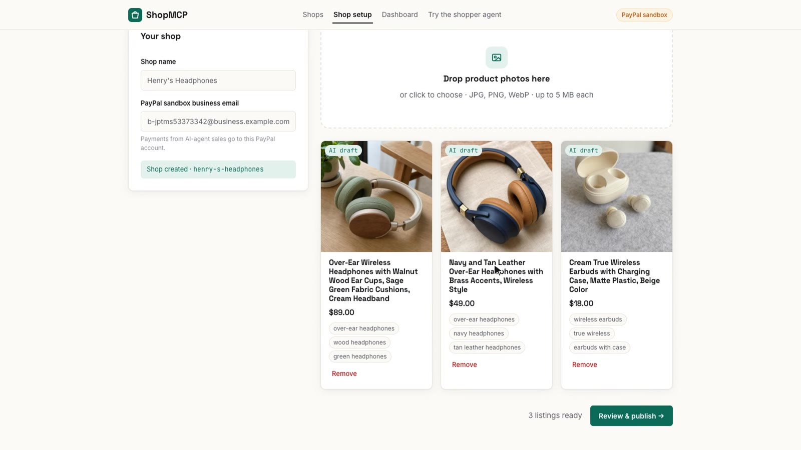
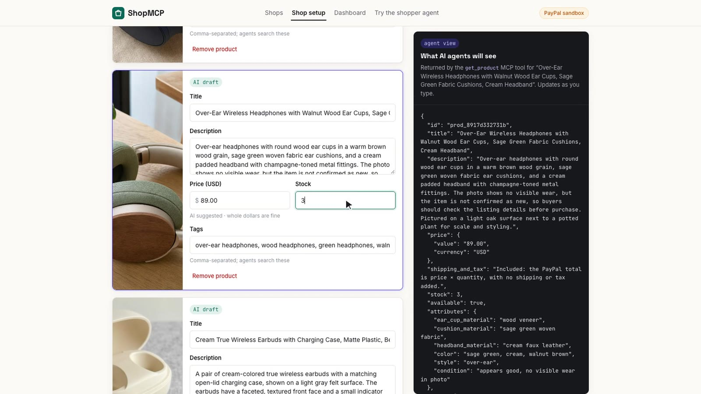
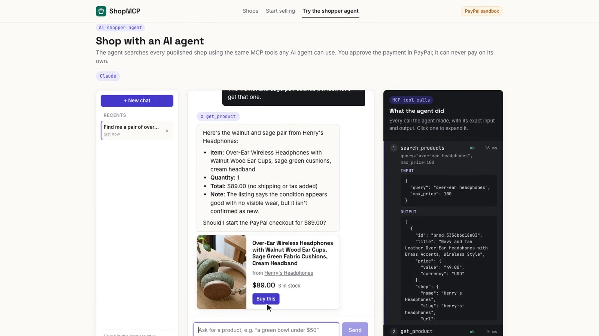
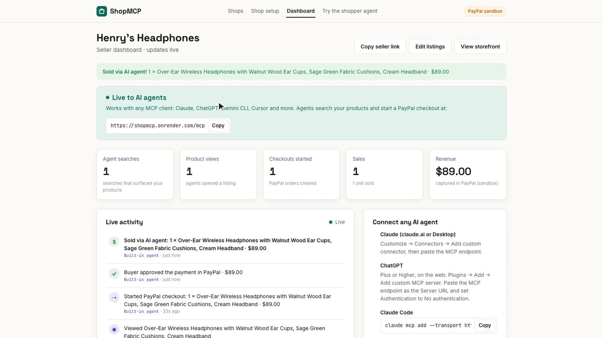
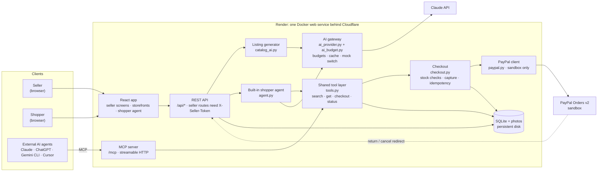
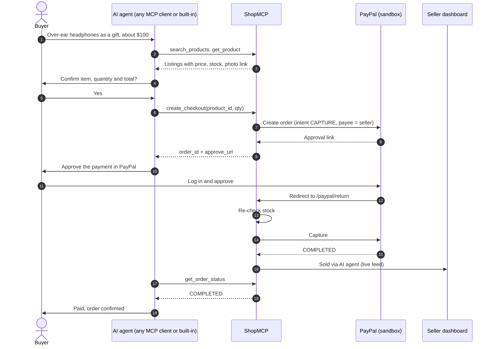
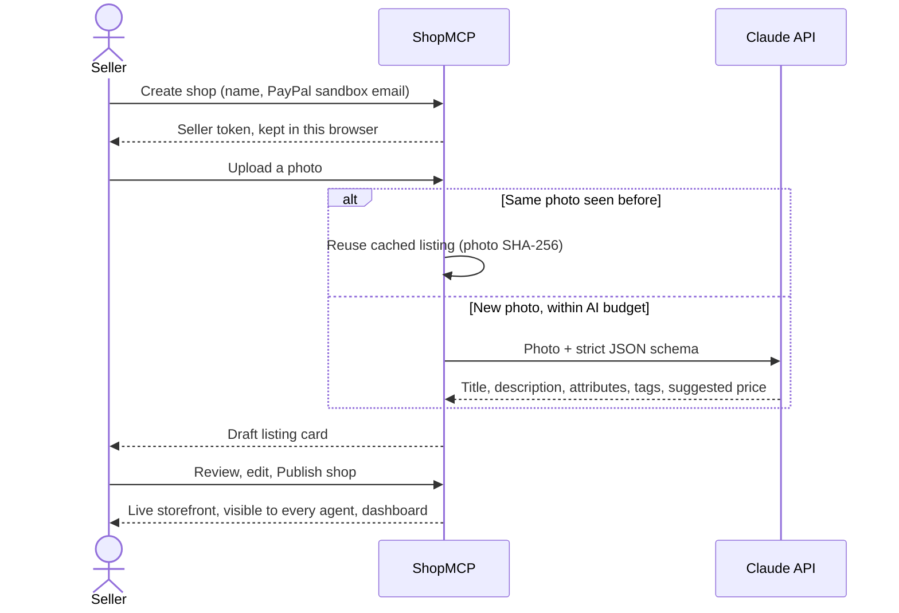

# ShopMCP

**Make any tiny shop buyable by AI agents.**

A small seller uploads product photos. Claude turns each photo into a structured listing, the seller checks price and stock, and publishes. Every published shop gets a storefront and an **MCP endpoint**, so any MCP-compatible AI agent (Claude, ChatGPT, Gemini CLI, Cursor, or your own) can search it and buy from it. Checkout runs on **PayPal Orders v2** with the seller as payee, and **the buyer approves every payment in PayPal. The agent can never pay on its own.**

**Live demo: https://shopmcp.onrender.com** · **Demo video:** <!-- TODO: YouTube link once uploaded --> *(YouTube link coming)* · [MIT license](LICENSE)

Built for the *Build What's Next with PayPal and AI* hackathon. All payments use the **PayPal sandbox**, so no real money moves.

| Photos → AI listings | Review: what agents will see |
|---|---|
|  |  |
| **Shopper agent: search, confirm, PayPal** | **Seller dashboard: "Sold via AI agent"** |
|  |  |

The demo shops on the live site (Henry's Headphones and six small makers) use **AI-generated product photos** (OpenAI image model) so no real brands or trademarks appear; their listings were written by Claude from those photos through the normal seller flow.

## Who it's for

Crafters, market vendors and other solo sellers who are too small for PayPal's own agent-ready and store-sync programs, but still want AI shoppers to find and buy their products. No integration work: photos in, agent-ready shop out.

## Try it in 2 minutes

You need a **PayPal sandbox Personal account** to approve payments (test money only):

<!-- TODO: sandbox buyer email + password for judges -->
- Email: *to be added*
- Password: *to be added*

Always open PayPal approval links in a **private/incognito window**. If you're logged into the PayPal developer dashboard in the same browser, the sandbox checkout page often fails to load.

### 1. Shop with the built-in agent (nothing to install)

1. Open **[shopmcp.onrender.com/agent](https://shopmcp.onrender.com/agent)** and ask, for example: *"Find me a pair of over-ear headphones to give as a gift, budget around $100."*
2. The agent searches, shows the product, and asks you to confirm. Say *"yes, buy it"*.
3. Click **Review & pay in PayPal**, copy the link into a private window, log in with the sandbox buyer, and approve.
4. Back in the chat, the page notices the approval and the agent confirms the order once the payment is captured. The right-hand panel traces every tool call.

### 2. Shop with your own AI agent over MCP

The MCP endpoint is **`https://shopmcp.onrender.com/mcp`** (streamable HTTP, no auth).

- **Claude Code:**
  ```bash
  claude mcp add --transport http shopmcp https://shopmcp.onrender.com/mcp
  ```
  Then ask Claude Code to find and buy something.
- **claude.ai or Claude Desktop:** **Customize → Connectors → Add custom connector**, paste the endpoint URL, and leave authentication empty. ([Anthropic's guide](https://claude.com/docs/connectors/custom/remote-mcp))
- **ChatGPT** (Plus or higher, on the web): **Plugins → Add → Add custom MCP server**, paste the endpoint as the **Server URL**, set **Authentication** to **No authentication**, and confirm. Then turn on ShopMCP in a chat. Tested: ChatGPT found, checked out and confirmed a purchase.
- **Gemini CLI:**
  ```bash
  gemini mcp add --transport http shopmcp https://shopmcp.onrender.com/mcp
  ```
- **Any other MCP client** (Cursor, VS Code, …): add the URL as a remote (streamable HTTP) server.

### 3. Be the seller

1. Open **[/sell](https://shopmcp.onrender.com/sell)**, enter a shop name and a PayPal sandbox **business** email, and drop in a few product photos (on a phone, tap the photo area to take a picture with the camera). Each one becomes an AI-drafted listing in a few seconds.
   **Payee email to use:** the demo's sandbox business account **`sb-jptms53373342@business.example.com`**, or any PayPal sandbox *business* email of your own. (PayPal routes the money there; a pasted `mailto:` prefix is removed automatically.)
2. **Review & publish:** edit title, description, price, stock and tags. The side panel shows the exact JSON an agent will receive. **Publish shop** puts it live on its storefront and to AI agents; after that, edits and newly added photos go live only when you click **Save changes**.
3. **Dashboard:** your MCP endpoint, sales stats, a live feed of what agents do (search → view → checkout → approved → **Sold via AI agent**), and inventory. Only the seller can open it (see [Security](#security)).

The hosted site has a small shared AI budget. If listing generation says the daily limit is reached, try the other two flows.

## Architecture

ShopMCP is **one web service**: a FastAPI app that serves the React frontend, the REST API and the MCP server from the same origin, with SQLite and product photos on a persistent disk. Claude and PayPal are the only external services.

### System overview



### Buying through an AI agent



The agent never touches money: it only receives an approval link, and the server captures the payment after the buyer approves in PayPal.

### Listing a product



### Design decisions

| Decision | Why |
|---|---|
| One service for frontend, API and MCP | One deploy, one disk, same origin (no CORS), nothing to keep in sync |
| One shared tool layer (`tools.py`) | The built-in agent and every external MCP client run the same code, so payment rules live in one place |
| Server-side capture, with `get_order_status` as a fallback | Agents can't move money; a missed return redirect still settles |
| SQLite on a persistent disk | Tiny catalogs, zero ops, survives redeploys |
| Seller tokens instead of accounts | No sign-up friction for small sellers; public shop ids can't be used to edit a shop |
| AI gateway with budgets and a photo cache | Hard cost cap on a public demo; the same photo is never paid for twice |
| Stateless MCP over streamable HTTP | No sessions to pin, works behind Cloudflare and with any MCP client |
| Mock AI provider | Development and tests run with no API cost; never used in the demo |

### Payment safety

- **The agent can't pay.** `create_checkout` only returns an approval link. The MCP server's instructions tell every agent to confirm the item and total first, hand the link to the user, and never claim an order is paid until `get_order_status` says `COMPLETED`.
- **The server captures, not the agent.** Capture happens on PayPal's return redirect. If that redirect is missed (the buyer closed the tab), `get_order_status` checks PayPal and captures then.
- **Stock is re-checked at capture.** If an item sold out while the buyer was approving, the order isn't captured and the buyer isn't charged.
- **Idempotent.** Refreshing the return page or capturing twice never double-charges (`ORDER_ALREADY_CAPTURED` is handled).
- **Sandbox only.** The PayPal client refuses any base URL that isn't the sandbox.

## MCP tools

The built-in shopper agent calls the same four Python functions as the MCP server (`backend/app/tools.py`), so both behave identically.

| Tool | Input | Returns |
|---|---|---|
| `search_products` | `query`, optional `max_price` (USD) | Up to 10 matches across all published shops, best first: id, title, price, shop (with storefront link), short description, stock, photo link |
| `get_product` | `product_id` | The full listing: description, attributes, tags, price (shipping and tax included), stock, photo link, shop and storefront link |
| `create_checkout` | `product_id`, `qty` (1–10) | `order_id`, `approve_url`, total. Creates a PayPal order with the seller as payee |
| `get_order_status` | `order_id` | `CREATED` / `APPROVED` / `COMPLETED` with a plain-language message (captures if the return redirect was missed) |

## How AI is used

AI runs both sides of the marketplace:

- **Listings from photos (Claude vision).** `catalog_ai.py` sends each photo to Claude with a strict JSON schema (title, description, attributes, tags, suggested price) and validates the result. Results are cached by the photo's SHA-256, so the same photo is never sent twice.
- **The shopper agent (Claude tool use).** `agent.py` runs Claude over the four tools above, with at most 6 tool rounds per message, low effort (shopping chat doesn't need deep reasoning) and prompt caching.
- **Agents as customers (MCP).** Any external agent can shop through the MCP server, and every action shows up on the seller's dashboard, credited to "MCP agent" or "Built-in agent".
- **Cost controls (`ai_budget.py`).** Every Claude call goes through one function that enforces a daily and a total USD budget, a daily call cap and a per-visitor hourly limit, before the call is made.
- **Models:** the hosted demo (and the demo video) runs `claude-haiku-5-5`: fast and cheap, and good enough for listings and the shopping agent. Set `AI_MODEL=claude-opus-5-5` for the strongest model. A `mock` provider (canned listings, a scripted agent that still calls the real tools and the real PayPal sandbox) is for development only.

### AI tools used to build it

- **Claude Code** (Anthropic): the coding assistant throughout: code, tests, debugging, deployment and these docs. The author reviewed and committed every change.
- **Claude Design:** designed the four main screens.
- **Claude API:** powers the product itself (above).
- **OpenAI** (demo assets only, not part of the app): `gpt-image-2` generated the brand-free product photos for the demo shops, and `gpt-4o-mini-tts` voiced the demo video's narration.

## Security

- **Seller tokens.** There are no accounts, and a shop isn't tied to its PayPal email (that's only where payments go). The browser that creates a shop owns it. Creating a shop returns a random token once, and the server stores only its SHA-256 hash. Every seller action (upload, edit, delete, publish, dashboard) requires it, so knowing a shop's public id isn't enough to change it. A **Copy seller link** button on the dashboard opens the shop on another device; the token travels in the URL `#fragment`, which browsers never send to servers.
- **No secrets in code.** All credentials come from environment variables; `.env` is gitignored, and AI error details are never logged (they can contain the API key header).
- **MCP Host check.** The MCP endpoint only answers requests addressed to its own host (DNS-rebinding protection).
- **Per-visitor limits.** The visitor IP comes from Cloudflare's `True-Client-IP` header, which a client can't spoof (verified on the hosted site). The global AI budgets are the hard cap either way.

## Run it locally

**Prerequisites:** Python 3.11+, Node.js 20.19+ or 22.12+ (tested with Python 3.13 and Node 24), and a [PayPal developer](https://developer.paypal.com) account. Sandbox credentials are under **Apps & Credentials** (Sandbox) → your app. A Claude API key is optional: without one, the app runs on the mock AI provider.

```bash
git clone https://github.com/robielkennedyswe/PayPal-Hackathon.git
cd PayPal-Hackathon
cp .env.example .env              # fill in Client_ID and Secret_Key (KEY=value, no space after "=")

# Backend (terminal 1)
cd backend
python3 -m venv .venv
.venv/bin/pip install -r requirements-dev.txt
.venv/bin/uvicorn app.main:app --reload --port 8000 --timeout-graceful-shutdown 3

# Frontend (terminal 2)
cd frontend
npm install
npm run dev                       # http://localhost:5173 (proxies /api, /mcp, /paypal, /uploads to :8000)
```

Open **http://localhost:5173**. API docs are at http://localhost:8000/docs.

- **Mock AI** (the default) picks a canned listing from words in the photo's *filename*: `blue_mug.jpg`, `white_vase.png`, `sage_bowl.jpg`. Other names get a generic draft.
- **Real Claude:** set `AI_PROVIDER=anthropic`, `AI_MODEL=claude-haiku-5-5` (or `claude-opus-5-5`) and `ANTHROPIC_API_KEY`.
- **Local MCP:** `claude mcp add --transport http shopmcp http://localhost:8000/mcp`.
- **Fresh start:** delete `backend/data/` (SQLite database + photos).

### Environment variables

Set in `.env` at the repo root (`.env.example` lists them all). Blank values use the defaults.

| Variable | Default | Purpose |
|---|---|---|
| `Client_ID` | *(required)* | PayPal sandbox app client ID |
| `Secret_Key` | *(required)* | PayPal sandbox app secret |
| `PAYPAL_BASE_URL` | `https://api-m.sandbox.paypal.com` | PayPal API base; non-sandbox URLs are refused |
| `AI_PROVIDER` | `mock` | `mock` or `anthropic` |
| `AI_MODEL` | | Claude model id, required for `anthropic` |
| `ANTHROPIC_API_KEY` | | Claude API key, required for `anthropic` |
| `AI_DAILY_BUDGET_USD` | `5.00` | Max estimated Claude spend per UTC day |
| `AI_TOTAL_BUDGET_USD` | `25.00` | Max estimated Claude spend overall |
| `AI_DAILY_CALL_LIMIT` | `300` | Max Claude calls per UTC day |
| `AI_CLIENT_HOURLY_CALL_LIMIT` | `40` | Max Claude calls per visitor per hour |
| `APP_BASE_URL` | `http://localhost:8000` | Public backend URL (PayPal return URLs, MCP host check). On Render: `RENDER_EXTERNAL_URL` |
| `FRONTEND_URL` | `http://localhost:5173` | Browser app URL (CORS, post-checkout redirect). On Render: `RENDER_EXTERNAL_URL` |
| `DATA_DIR` | `backend/data` | SQLite database and uploaded photos (`/var/data` in Docker) |

### Test a payment from the command line

```bash
backend/.venv/bin/python scripts/paypal_smoke_test.py    # creates a $34 sandbox order, prints the approve link, captures after you approve
backend/.venv/bin/python scripts/vision_smoke_test.py    # photo → listing JSON (works in mock mode)
```

## Tests

```bash
cd backend && .venv/bin/python -m pytest          # 73 tests
cd frontend && npm run build && npm run lint      # type-check, build, lint (oxlint)
```

The tests run on a throwaway database with the mock AI. PayPal and Claude are faked, and any real network call fails the test. They cover checkout outcomes (completed, sold out at capture, already captured, PayPal errors), the MCP tools end to end, the shopper agent, AI budgets and caching, the dashboard feed, and seller-token access on every seller route.

## Deployment (Render)

The hosted demo is one Docker web service defined in [`render.yaml`](render.yaml) (Render → New → Blueprint):

- The [`Dockerfile`](Dockerfile) builds the frontend with Node, then runs FastAPI on Python 3.13, which serves the built frontend from the same origin.
- A 1 GB persistent disk at `/var/data` keeps the database and photos across deploys (this needs a paid instance).
- Secrets (`Client_ID`, `Secret_Key`, `ANTHROPIC_API_KEY`) are entered in the Render dashboard; everything else is in `render.yaml`.
- Every push to `main` redeploys. Health check: `/api/health`.

To build the image on an Apple Silicon Mac, use `docker build --platform linux/amd64 .`: a native arm64 build crashes on import of `cryptography` under Docker Desktop.

## Project structure

```
backend/app/
  main.py            FastAPI routes, seller-token checks, serves the built frontend
  mcp_server.py      MCP server (4 tools, payment-safety instructions) at /mcp
  tools.py           the 4 tool functions, shared by MCP and the built-in agent
  checkout.py        create_checkout / complete_order: stock checks, capture, idempotency
  paypal.py          Orders v2 client: cached OAuth token, create/get/capture, sandbox guard
  catalog_ai.py      photo → listing (Claude vision, strict JSON schema, cache)
  agent.py           built-in shopper agent (Claude tool use)
  ai_provider.py     mock vs anthropic switch; every Claude call goes through it
  ai_budget.py       AI cost limits
  seller_auth.py     seller tokens
  activity.py        dashboard events
  db.py, models.py   SQLite + SQLModel tables
backend/tests/       pytest suite
frontend/src/        React + Vite + TypeScript: seller screens, storefront, shopper agent
scripts/             PayPal and vision smoke tests
render.yaml, Dockerfile
```

## Limitations and next steps

- **Sandbox and USD only.** Going live needs PayPal production credentials and a seller onboarding flow.
- **No seller accounts.** Access is by seller token; a lost token can be reissued by the operator (`python -m app.seller_auth <shop_id>`).
- **Approval opens PayPal's page.** The agent's approval card links to PayPal rather than embedding the PayPal JS SDK button.
- **Next:** per-shop MCP endpoints, shipping and tax, PayPal webhooks instead of return-URL capture, and "snap to find" (photo → product search).

## License

[MIT](LICENSE) © 2026 Robiel Kennedy
